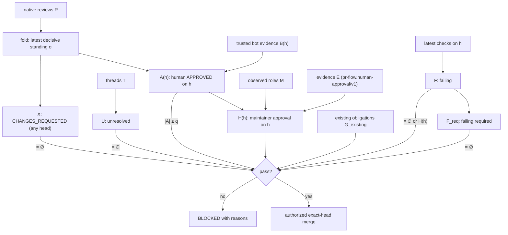

# Merge gate: any-approval rule (2026-10-29)

Source: Err, 2026-10-29 — "Any approval should count, and any rejection,
request for changes, unresolved review threads, or required check failing,
should block. Any failing check at all, should require a human maintainer's
accounts approval, or check-able evidence of a human approval through an
automation." This extends the existing pr-flow gate. It **replaces** the
five-round soft minimum / unanimous-early-exit convergence condition
(2026-10-03) as a merge condition. Everything else the gate already enforced
(exact head, settled findings, mandatory overrides, pending/skipped required
checks, artifact verdicts, review-body answers, waivers) is unchanged.

Implementation: `scripts/pr_flow/law.cljc` (`decisive-reviews`,
`current-head-approvers`, `change-requesters`, `human-approval-evidence-valid?`,
`human-maintainer-approved?`, `any-approval-gate`, folded into `merge-gate`).
Laws are tested one per `deftest` in `scripts/test_any_approval.cljs`.

## Objects

| Symbol | Meaning |
| --- | --- |
| `h` | the PR head SHA (40 hex) observed at gate time; `h = h_snapshot` |
| `R` | native reviews `r = (login, type, state, commit, t)`, `state ∈ {APPROVED, CHANGES_REQUESTED, DISMISSED, COMMENTED, PENDING}` |
| `B(h)` | bot approvers from trusted review evidence (`approved-heads`, inventory identities incl. Antigravity) bound to `h` |
| `T` | review threads, `resolved(τ) ∈ {true,false}` |
| `C` | latest run per `(name, workflow)` on `h` (`latest-checks`), `req(c)`, `fail(c)` |
| `M` | observed role map `login → {admin, maintain, write, …}` read from GitHub |
| `a` | PR author login |
| `E` | human-approval evidence records |

## Predicates

- **Standing.** `σ(ℓ) = state` of the latest review by `ℓ` with state in
  `{APPROVED, CHANGES_REQUESTED, DISMISSED}`; `DISMISSED ↦ ⊥`. COMMENTED and
  PENDING never change standing. This is a fold:
  `σ = foldl (λ s r. if decisive(r) then s[login(r) ↦ r] else s) ∅ (sort_t R)`.
- **Human.** `Hum(ℓ) ⇔ type(ℓ) = User ∧ ¬bot(ℓ)`.
- **Maintainer.** `Mnt(ℓ) ⇔ Hum(ℓ) ∧ M(ℓ) ∈ {admin, maintain} ∧ ℓ ≠ a`.
- **Approvers.** `A(h) = B(h) ∪ { ℓ | Hum(ℓ) ∧ σ(ℓ) = APPROVED ∧ commit(σ(ℓ)) = h }`.
  Raw Bot `APPROVED` reviews count only through `B(h)`, which retains the
  existing scope/incomplete-review revocation.
- **Rejecters.** `X = { ℓ | σ(ℓ) = CHANGES_REQUESTED }` (any head: sticky until
  the same reviewer approves or the review is dismissed; from anyone).
- **Unresolved.** `U = { τ ∈ T | ¬resolved(τ) }`.
- **Failing.** `F = { c ∈ C | fail(c) }`, `F_req = { c ∈ F | req(c) }`.
- **Evidence.** `valid_h(e) ⇔ schema(e) = "pr-flow.human-approval/v1" ∧
  head(e) = h ∧ Mnt(approver(e)) ∧ approver-type(e) = User ∧
  source(e).kind ∈ {issue-comment, review, environment-approval} ∧ source(e).id ≠ ⊥`.
- **Human approval.** `H(h) ⇔ (∃ℓ ∈ A(h). Mnt(ℓ)) ∨ (∃e ∈ E. valid_h(e))`.

## The gate

```
pass(h) ⇔ |A(h)| ≥ q            (q = :review/approval-quorum, default 1)
        ∧ X = ∅
        ∧ U = ∅
        ∧ F_req = ∅
        ∧ (F = ∅ ∨ H(h))
        ∧ G_existing(h)          (exact head, settled findings, mandatory reviewers,
                                  no pending/skipped required checks, artifacts,
                                  review bodies answered)
```

As a fold over the evidence stream: each observation contributes a monoid
element `(A, X, U, F_req, F, H)` under `(∪, ∪, ∪, ∪, ∪, ∨)`; the verdict is
the single predicate above applied to the folded value, so order of
observation does not matter (L9) and adding a blocker can never turn BLOCKED
into PASS except through the named supersession paths (same-reviewer approval,
dismissal, thread resolution, a green rerun, human approval for non-required
failures).



## Laws (one test each, `test_any_approval.cljs`)

- **L1 Any approval counts.** A listed-bot, Antigravity, any human or Err's
  approval on `h` alone satisfies `|A(h)| ≥ 1`; zero approvals never pass.
- **L2 Exact head.** An approval whose commit ≠ `h` contributes nothing.
- **L3 Any change request blocks**, from any account, across pushes, until
  that reviewer approves later or the review is dismissed; COMMENTED never
  supersedes.
- **L4 Any unresolved thread blocks.**
- **L5 Failing required check blocks**, even with `H(h)`.
- **L6 Any failing check needs `H(h)`.** Bot approvals, `write`-role humans,
  bots with admin, and approvals on older heads do not satisfy it; the
  approver must not be the PR author.
- **L7 Evidence is verifiable.** Wrong head, schema, approver type, role or
  source, or a missing source id, invalidates `e`.
- **L8 No round limit, no early-fix obligation.** Round count, unanimity and
  `:review/min-rounds` never affect the verdict; a non-blocking (P2/P3) item
  may be deferred in any round. P0/P1 still need a fix or an independently
  corroborated rejection (severity rule, not a round rule).
- **L10 Unrequested reviewers are never awaited.** A reviewer outside the
  mandatory set (e.g. Codex, which runs only on direct request since
  2026-10-29) that is absent, pending or skipped never blocks; its approval
  still counts when given.
- **L9 Purity.** The gate is a deterministic function of its inputs and is
  independent of review order.

## Minimal verifiable human-approval evidence

An automation records human approval as one of:

1. A native issue comment authored by the maintainer's own User account
   containing `<!-- pr-flow-human-approval:v1 head=<40-hex head> -->`
   (`law/human-approval-comment->evidence` parses it; GitHub authenticates the
   author).
2. A record with the same fields from an environment-protection approval or a
   native review, read by the CLI from GitHub:

```edn
{:schema "pr-flow.human-approval/v1"
 :head "<40-hex>" :approver "<login>" :approver-type "User"
 :source {:kind :issue-comment|:review|:environment-approval :id <native id> :url "..."}
 :at "<ISO-8601>"}
```

The gate never trusts a claimed role: the CLI reads
`repos/{repo}/collaborators/{login}/permission` and only `admin`/`maintain`
qualify. Evidence binds to one head; a push invalidates it.

## What changed vs. 2026-10-03

- Replaced: "five completed rounds or unanimous current-head approval" as a
  merge condition (`law/loop-verdict` is still computed and reported).
- Widened: native APPROVED reviews from human accounts now count toward quorum
  (previously only allowlisted Bot logins).
- Tightened: any account's standing CHANGES_REQUESTED blocks; a failing
  non-required check (deterministic or optional reviewer job) now requires
  `H(h)` instead of being ignored (optional reviewer) or unconditionally
  blocking (non-required deterministic).
- Removed (Err, 2026-10-29 follow-up): the round limit entirely
  (`:review/min-rounds`, `loop-verdict` in the gate output, the CLI refusal to
  send a deferral in early rounds) and the early-round fix-over-defer
  obligation. Rounds are still counted and printed by `status` for information.
- Codex: auto-review on push is off; `reviewers.edn` marks it
  `:on-request-only`. Nothing waits on Codex unless it is named in
  `--reviewers` or repo policy.
